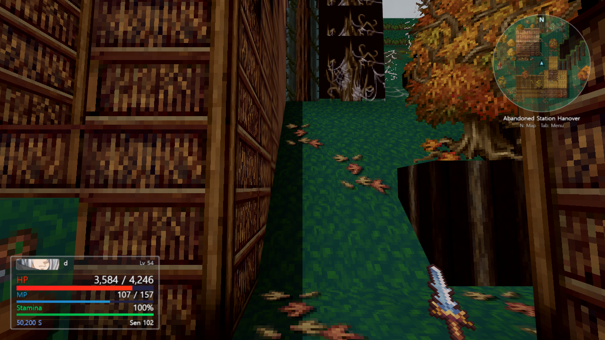
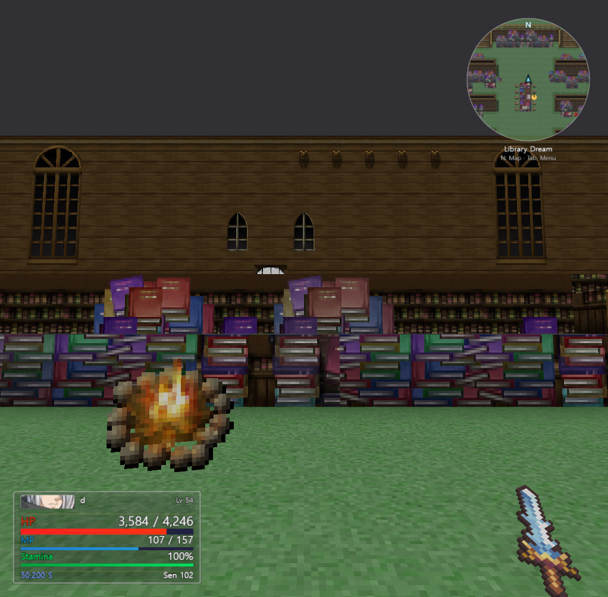
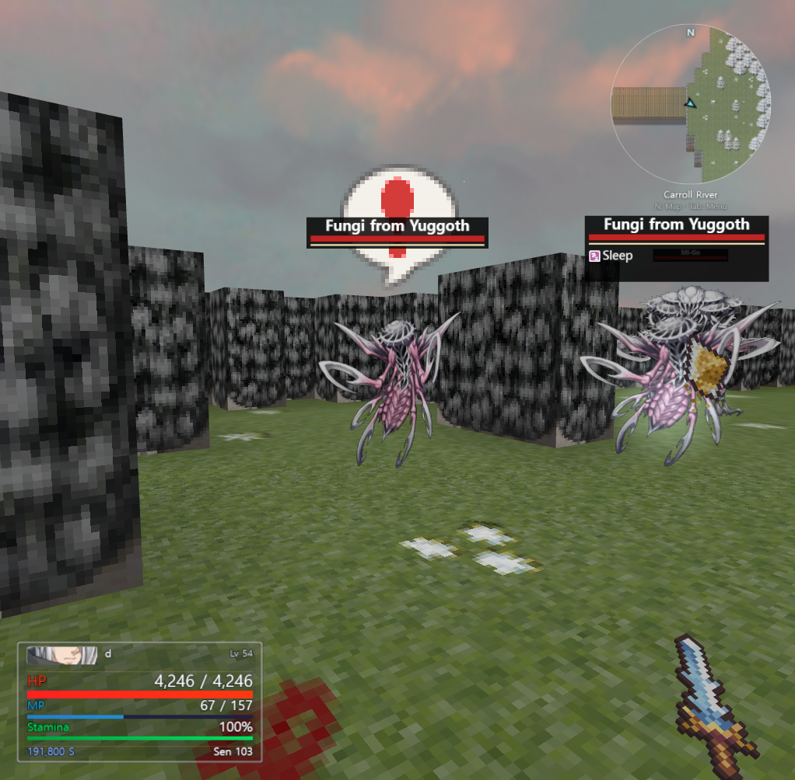
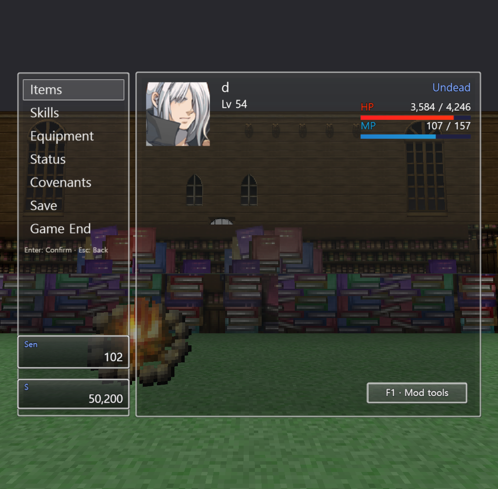
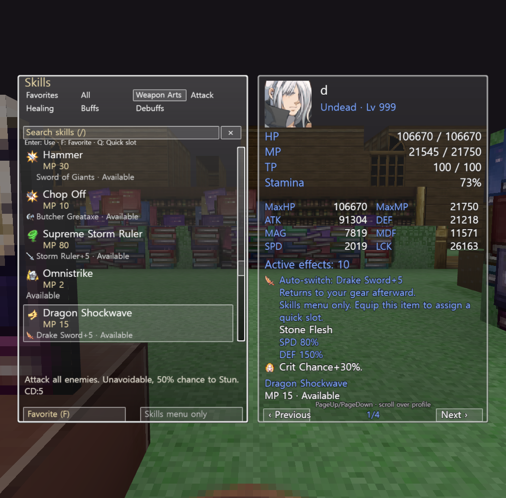

# BLACK SOULS II VR

Unofficial fan mod for playing BLACKSOULS II in first person on your Windows PC
or with a PC VR headset. Not affiliated with the original developer or publisher.
No game files included - you need the original game.

Meta Quest 3 connects through Quest Link, Air Link or Virtual Desktop.

## Download

**[Download for Windows](../../releases/latest)**

Prefer a ZIP? Download the **portable ZIP** from the same release page.
Setup and controls are in the README / CONTROLS files inside the ZIP
(English, Japanese, Korean and Simplified Chinese).

Run the installer, then open **BLACK SOULS II VR** from the Start menu.
A desktop shortcut is optional during setup.

## Gameplay screenshots

Desktop gameplay captures from v0.2.33 and an isolated v0.2.45 Skills preview,
with an initialized character and player portrait. Stats and appearance depend
on your save.

### First-person exploration

Explore Nameless Forest near Hanover from a first-person view.

### HUD and area map

Library Dream, with a translucent status HUD and circular minimap.

### Combat and status effects

Facing Fungi from Yuggoth in Carroll River. Fairy Powder puts an enemy to Sleep;
the game's status icon appears beneath its health bar.

### Familiar menus

Manage items, skills and equipment through the original-style menu.

### Skills and character profile

Press **R** to browse skills beside your stats and complete active effects.
Pin favorites with **F**, change categories with **← / →**, or press **/** to search.
Click or press **Enter** to use a skill directly; **Q** opens quick-slot assignment.
Costs, cooldowns and unavailable-skill reasons update while browsing.

**Weapon Arts** includes skills from compatible weapons, pistols and shields in
your bag. R switches to the item shown for that action, then returns to your
equipped gear. Costs and delayed hits use that item's stats and effects. To put
a skill borrowed only from bag equipment in a quick slot, equip its source first.

This isolated v0.2.45 preview uses a copied character and original game artwork;
it does not write game saves or achievements.

## Gameplay video

[Watch on YouTube](https://www.youtube.com/watch?v=J8WaV70g5cc).
This video shows an earlier version; the current interface and features may differ.

## Features

- A Windows installer, automatic game-folder discovery and updates from this project's releases.
- Separate PC and VR layouts, clearer translucent HUD panels and a circular area minimap.
- Familiar original-style menus, readable dialogue choices and the game's own status icons.
- Gameplay fixes for equipment effects, consumables, pickups and dialogue.
- Corrections to terrain, floating scenery, area skies and environmental colours.
- Earned Steam achievement support when playing a compatible Steam copy.

## Play on your PC

1. Open the app. It looks for BLACK SOULS II automatically and fills in the game folder. If it finds several copies, choose one. If it finds none, click **Browse** and choose the folder containing `Game.exe`.
2. Select **Play on PC**, then click **Launch on PC**. Keep the launcher open while playing.
3. Click inside the game window to use the mouse.

| Action | Control |
| --- | --- |
| Move / run | WASD / Shift |
| Look | Mouse |
| Attack / guard | Left / right mouse button |
| Interact | E or Enter |
| Dodge | Space |
| Menu / cancel | Tab / Esc |
| Area map | N |
| Skills / favorites | R |

## Play on Meta Quest 3

1. Connect your headset to your Windows PC using Quest Link, Air Link or Virtual Desktop.
2. Start that VR connection before opening the game.
3. In the launcher, choose your game folder, select **Play in VR** and click **Launch in VR**.
4. Click **ENTER VR** at the bottom of the game window and put on your headset.

Quest requires the PC to run the game; this download does not install on the headset.
To collect a world item, bring your right hand close and squeeze the grip.
An empty left hand can also collect items; holding a shield keeps its guard control.
Successful grabs give a short vibration. Flick the right stick down for normal
interactions with items, people and doors.
See [all controls](docs/upstream/CONTROLS_en.txt) for the controller buttons.

## Help

The app checks common game folders, Downloads, Desktop, Documents and Steam libraries.
It remembers your selected folder after you launch the game.

- **What do I need?** Windows 10/11, an up-to-date Chrome or Edge, and your original game.
- **VR NOT SUPPORTED?** Start Quest Link or SteamVR first, close the game window, then click **Launch** again.
- **VR is still connecting?** Keep the headset ready and follow the progress message. Cancel keeps the unfinished connection owned until it closes. If a connection or exit stalls, use **Reset VR connection** when offered; wait for confirmation before entering again. If recovery cannot confirm closure, save if possible and reopen the game window. If Quest Link itself is frozen, restart the headset and Link, and check warnings in the Meta Link PC app.
- **Missing tiles or emotes?** Installing the optional RPG Maker VX Ace RTP may help.
- **Navigation:** PC has a circular, translucent minimap with your position, facing direction and exits. Press **N** or open **Mod tools → Map** for the full area map. In VR, look above your left controller. Use **Back** or **B** to return. Hide the minimap in **Mod tools → Settings → Combat / display settings**.
- **PC and VR layouts:** PC has larger menus and a fixed screen HUD. VR keeps menus in front of you and the HUD above your left controller. Switching modes changes both the layout and the control hints.
- **Menus:** The original layout returns: Items, Skills, Equipment, Status, Covenants, Save and Game End on the left, character details on the right. Use the mouse or arrows and **Enter / Z**. **Esc / X** goes back. Scroll long lists with the wheel or scrollbar. Open the separate **Mod tools** button (or **F1** while the menu is open) for Map, Load, Co-op and Settings.
- **PC HUD:** Translucent panels use the original battle portrait strip, gauges and status icons. Resources stay in a fixed corner; priority effects stay visible above them. Open **Menu → Status** for every effect. Item pickups appear quietly at the lower right and repeated gains combine.
- **Status effects:** Nearby enemies show their name, health and effects overhead. VR keeps the wrist HUD; extra effects cycle into view and **Menu → Status** shows the complete list.
- **Held equipment:** PC weapons rest low at the side and disappear during menus and dialogue, keeping the room and people in view.
- **Stats and speed:** Equipment changes combat stats, damage, resistances and on-hit effects. AGI affects formulas that use it; walking speed is controlled separately by Run like Dodo. Extra-action bonuses shorten desktop and ranged attack recovery. VR melee follows your physical swing.
- **Weapon stun:** Successful stun effects interrupt enemy attacks and briefly prevent actions. The enemy's effects show the original Stun icon. Listed chances are adjusted by enemy resistance and luck; immune enemies cannot be stunned.
- **Where are my saves?** Mod saves are in the `saves` folder beside the launcher. Your original game and original saves are not changed. Setup keeps mod saves during upgrades and uninstall.
- **Updates:** Download new versions from [this project's releases](../../releases). Click **Check for updates** in the launcher. If an update is available, click **Download update**, then open setup when prompted. Your saves are kept.

A [portable ZIP](../../releases) is also available:
extract it outside your game folder and run `BLACKSOULS_VR/BlacksoulsVR.exe`.
For more help, see the [full setup guide](docs/upstream/README_en.txt) or [report a problem](../../issues).

## Credits

VR mod by [Lobewarms](https://github.com/Lobewarms/BLACKSOULS2_VR-release).

## Terms

- Free to download and play.
- Videos and streams of play are welcome, monetized ones included. For the
  original game's own streaming rules, follow its developer's guidelines.
- Modified versions may be shared for free if they credit
  [the original mod's page](https://github.com/Lobewarms/BLACKSOULS2_VR-release)
  and clearly state that they are modified, not the original.
- To share the original, share
  [its page's link](https://github.com/Lobewarms/BLACKSOULS2_VR-release)
  rather than the file.
- No selling, and no distribution bundled with the original game's files.

These terms summarize the original mod's [LICENSE](LICENSE). BLACKSOULS II
and its assets belong to their respective rights holders.
