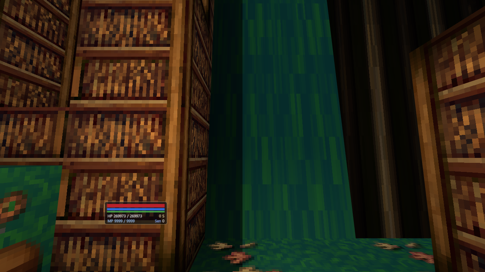
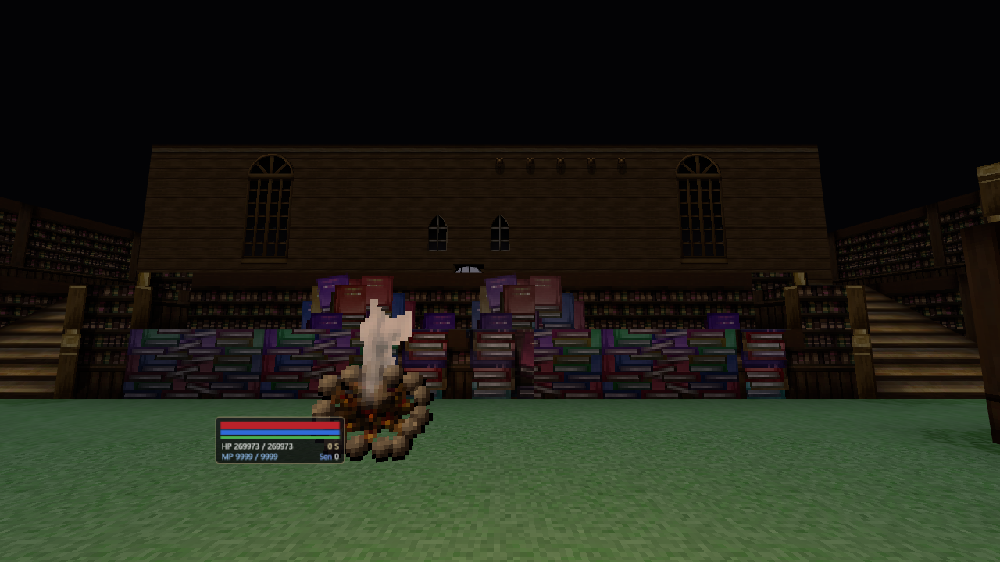
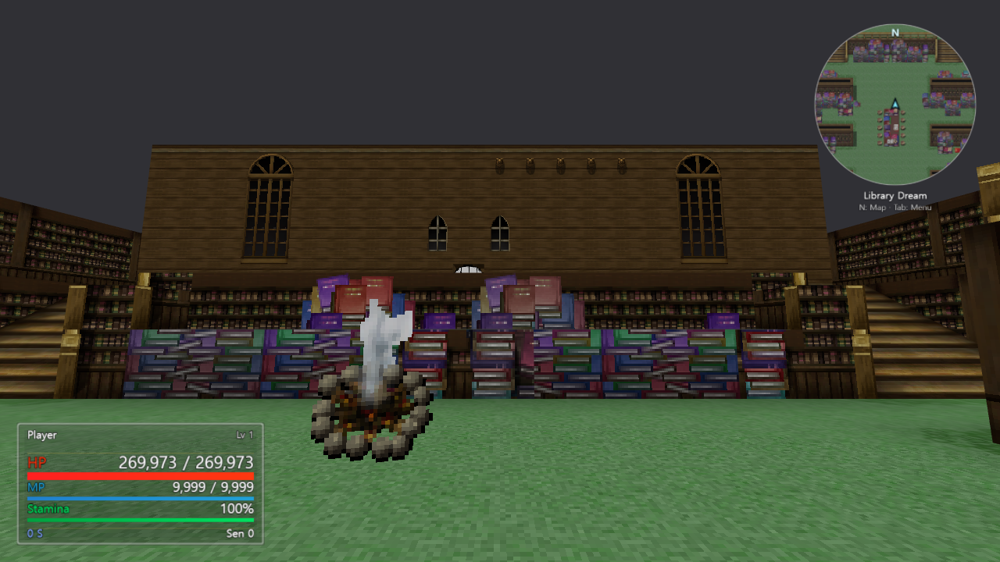
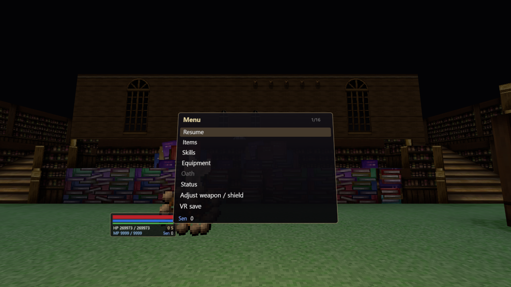
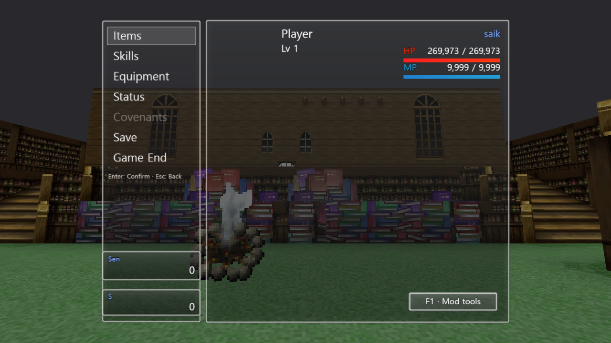
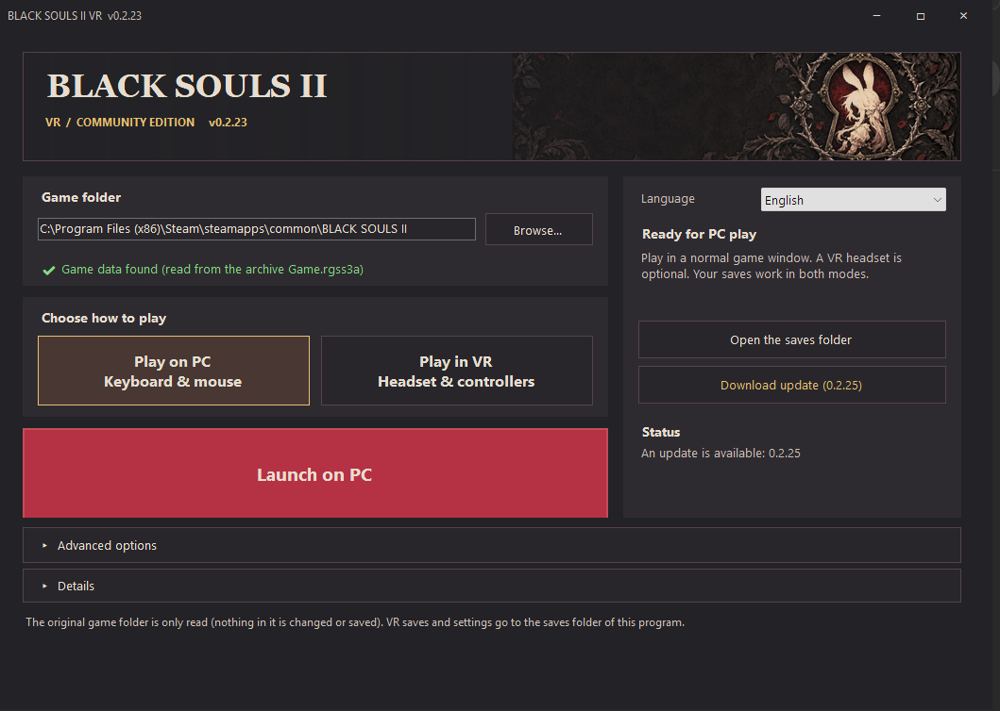

# Actual upstream versus community version

## Owned weapon arts preview (v0.2.45)

[R Weapon Arts](weapon-skills-0.2.45-owned-arts.png) shows Dragon Shockwave from
an owned Drake Sword+5 while the copied character keeps their normal equipment.
The original portrait, skill/equipment icons, window skin and library scenery
come from the selected installed game. The selected action shows its source,
MP cost and automatic return explanation beside the normal character profile.
This is an isolated in-memory UI preview, not a combat victory or an upstream
comparison. No original records, player saves or achievements are written.
No physical-headset playtest is claimed.

## Skills browser preview (v0.2.44)

[Skills favorites and live profile](skills-browser-0.2.44-favorites.png) shows the
current source renderer with an isolated copy of an initialized character and
original-game portrait, window skin, icons and library scenery. Skills are pinned
through the browser's real search/favorite controls. The image demonstrates
categories, per-row resource/status details, direct use, separate assignment and
selected descriptions beside the existing profile. No gameplay saves, original
game records or achievements are written. This is a standalone menu preview,
not a boss victory or an upstream comparison. No physical-headset playtest is
claimed. The earlier v0.2.43 domain example remains below with its original label.

## Skills profile preview (v0.2.43)

[Skills and character profile](skills-profile-0.2.43-domain-example.png) uses the
current source renderer with a copy of an initialized save and the installed
game's original portrait, window skin, icons and library scenery. The original
Heavenly Beast Domain state is applied only to the isolated in-memory character
to demonstrate effective ATK/MAG suppression and the healing-reversal warning.
It is a standalone interface preview, not a boss victory or an upstream comparison.
No saves, achievements, game records or renderer functions are changed by the
capture controls. The image follows the browser's1020x1004 viewport; the runtime
source is pinned in the comparison section below. No headset playtest is claimed.

## Current gameplay previews (v0.2.33)

The main README uses these newer standalone gameplay captures. They use the
v0.2.33 production renderer at runtime commit
32bd81b1dd6d81416a0f2858dbd78a8f0edac82b with an initialized level54 character,
including its selected original-game portrait. They replace the placeholder
character screenshots in the main README; the paired v0.2.25 comparisons below
retain their original capture state and labels.

- [Forest exploration with player portrait](gameplay-0.2.33-forest.png)
- [Library Dream HUD and minimap](gameplay-0.2.33-hud.png)
- [Carroll River combat and Sleep](gameplay-0.2.33-combat.png)
- [Original-style menu with full portrait](gameplay-0.2.33-menu.png)

These examples were staged in an isolated session reading an initialized save.
Private controls position the camera, change areas, invoke owned actions and
pause for capture; the production renderer, lighting, materials and HUD drawing
remain unchanged. The combat example uses owned Fairy Powder through the normal
quick-item/projectile path, applying the original Sleep state to a real enemy.
Enemy health, names and status icons are game-rendered, not image overlays.
The forest capture is1280x720; the other captures are1022x1004, following the
browser's current viewport. No original game files, saves or private controls
are distributed; these are application screenshots, not headset playtests.

## Paired upstream comparisons (v0.2.25)

These comparisons run two different clients against the same locally owned game:

| Client | Verified source |
| --- | --- |
| Lobewarms upstream | Original 2026.10.18-1 release ZIP at commit d39c2afd830c7be7fbbe2a86380f9c490e377bf7 |
| Community fork | Version 0.2.25 runtime at commit 786bdba1df20d78dddc5163e5ca4fcb08f3bb4b1 |

All 60 upstream app files were verified byte-for-byte against the published ZIP.
The clients keep their own rendering, lighting, screen tones, geometry and UI.
Both use a 1280 x 720 viewport, the same starting map/tile, north-facing camera
and 0.12-radian pitch. Camera height follows each client's own terrain.

Private capture controls pause actor logic, match the camera, open the menu and
save the rendered canvas. They do not replace lighting, materials or screen
tones. Debug map launches use their default new-game test state and do not write
saves. These are desktop visual checks, not physical-headset testing.

The direct map launch also skips the opening character setup. Its initial
placeholder actor has an empty portrait name, so the fork's HUD and menu have
no face to load in these captures. These examples do not test portraits from
an initialized gameplay save; no unrelated portrait was substituted.

**Correction:** the earlier red-versus-green pair showed this fork with two
different tone settings. It was not an upstream-versus-fork comparison and has
been removed. Upstream resets the map screen tone to neutral.

No original game asset files or saves are distributed here; the images show the mod
reading a locally owned game. Original game artwork belongs to its rights holders.

## Forest terrain — map 161, tile 26,50

### Upstream d39c2af

### Community 0.2.25

## Desktop HUD — Library Dream, map 101, tile 22,23

### Upstream d39c2af

### Community 0.2.25

## Main menu — same Library Dream view

### Upstream d39c2af

### Community 0.2.25

## Runtime source diff

[Read the literal JavaScript source diff](upstream-runtime.diff).
It compares original ZIP entries with the committed fork files, matching moved
modules by filename. The diff retains actual import-path changes and normalizes
line endings. It includes new fork runtime modules and is intended for review.
The current source comparison is version 0.2.46 at commit
4a82c174e1a17aab689dea8df17866619b45fd9c; the captured image pairs above remain
the labelled version 0.2.25 comparison.
The complete PR also contains the launcher, build tools, tests and documentation.

Ignoring relative import-path moves and line endings for the summary only:
48 original modules retained, 15 unchanged, 33 modified, and 46 new fork modules.
Modified original modules contain 4,327 added and 941 removed lines after those
import-path moves are normalized.

## Launcher screenshot supplied by the fork maintainer

The supplied image shows the installed community launcher at version 0.2.23
with an update to 0.2.25 available. It shows PC/VR selection, automatic game
discovery, collapsible options and the update button. This is a standalone
community screenshot, not an upstream comparison.

