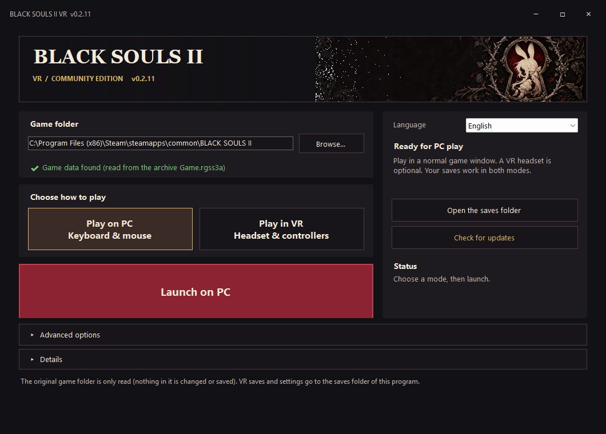

# Actual upstream versus community version

These comparisons run two different clients against the same locally owned game:

| Client | Verified source |
| --- | --- |
| Lobewarms upstream | Original 2026.10.18-1 release ZIP at commit d39c2afd830c7be7fbbe2a86380f9c490e377bf7 |
| Community fork | Version 0.2.25 runtime at commit 786bdba1df20d78dddc5163e5ca4fcb08f3bb4b1 |

All 60 upstream app files were verified byte-for-byte against the published ZIP.
The clients keep their own rendering, lighting, screen tones, geometry and UI.
Both use a 1280 x 720 viewport, the same starting map/tile, north-facing camera
and 0.12-radian pitch. Camera height follows each client's own terrain.

Private capture controls pause actor logic, match the camera, open the menu and
save the rendered canvas. They do not replace lighting, materials or screen
tones. Debug map launches use their default new-game test state and do not write
saves. These are desktop visual checks, not physical-headset testing.

**Correction:** the earlier red-versus-green pair showed this fork with two
different tone settings. It was not an upstream-versus-fork comparison and has
been removed. Upstream resets the map screen tone to neutral.

No original game asset files or saves are distributed here; the images show the mod
reading a locally owned game. Original game artwork belongs to its rights holders.

## Forest terrain — map 161, tile 26,50

### Upstream d39c2af

### Community 0.2.25

## Desktop HUD — Library Dream, map 101, tile 22,23

### Upstream d39c2af

### Community 0.2.25

## Main menu — same Library Dream view

### Upstream d39c2af

### Community 0.2.25

## Runtime source diff

[Read the literal JavaScript source diff](upstream-runtime.diff).
It compares original ZIP entries with the committed fork files, matching moved
modules by filename. The diff retains actual import-path changes and normalizes
line endings. It includes new fork runtime modules and is intended for review.
The complete PR also contains the launcher, build tools, tests and documentation.

Ignoring relative import-path moves and line endings for the summary only:
48 original modules retained, 20 unchanged, 28 modified, and 35 new fork modules.
Modified original modules contain 2,443 added and 620 removed lines after those
import-path moves are normalized.

## Additional community launcher example

This is a standalone community screenshot from version 0.2.11, not a comparison
with upstream. It shows PC/VR selection, discovery and collapsible options.

