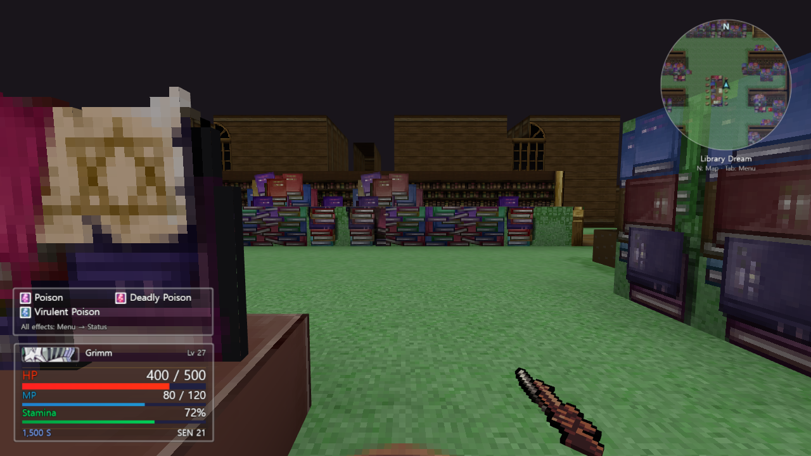
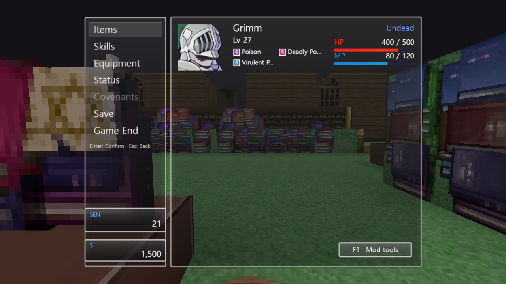
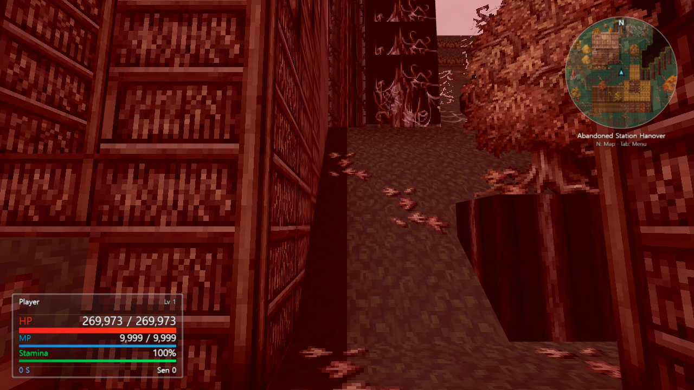
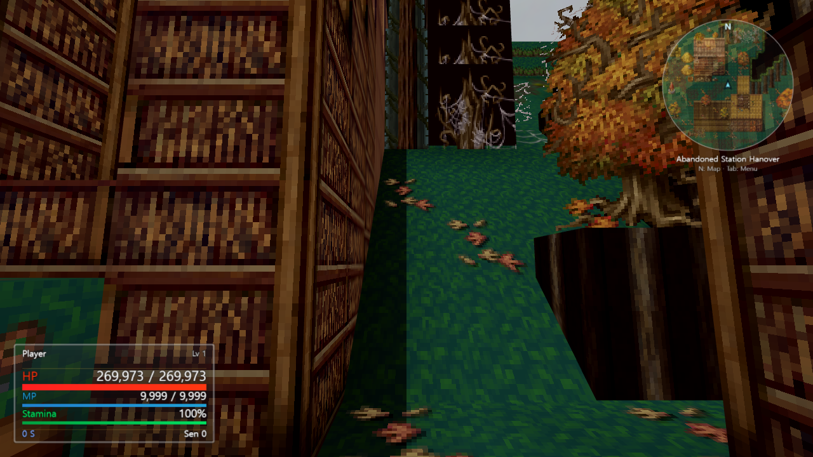

# Sample screenshots

These are captured application renders, not concept art. The launcher and PC
interface examples were captured during earlier community versions, as labelled
below. The environmental comparison uses version 0.2.25 at the same camera
position. Review scenes use test character values and are not a normal save.

No original game asset files or saves are distributed here; the images show the mod
reading a locally owned game. Original game artwork belongs to its rights holders.

## Windows launcher

PC/VR mode selection, automatic game-folder discovery and collapsible options.
Captured in version 0.2.11.

## PC HUD and minimap

Translucent resource and status panels, original game icons, a circular minimap,
and a weapon positioned toward the edge of the view. Captured in version 0.2.12.

## Familiar menu layout

Commands on the left and character details on the right, with separate mod tools.
Captured in version 0.2.12.

## Natural environmental colours

The same Nameless Forest view near Hanover, rendered in version 0.2.25.
The first image uses the original full environmental tone for comparison.
The second uses the community version's restrained environmental grade.
Source grass stays green; wood and authored autumn foliage keep their own colours.

### Original full environmental tone

### Community environmental grade

These are desktop visual examples. They do not document physical-headset testing.
